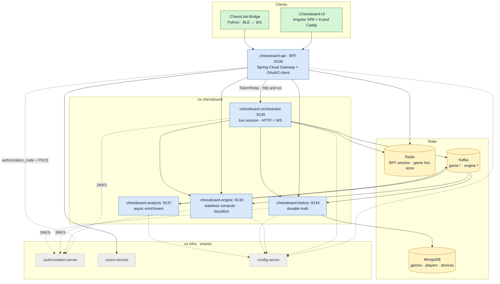

# ChessBoard — Architecture

Bird's-eye view of the ecosystem: what exists, where it lives, who owns which truth and why it has this shape. It does **not** explain how each module is built (each repo's README does) nor how an endpoint works inside (that is internal documentation). Anything that changes weekly — exact versions, phase status, debt — is left out on purpose.

Verified against the code on 2026-09-14.

## 1. What it is

A platform to play chess against Stockfish or against another person, from the browser or from a **physical board** (Millennium eONE ChessLink over BLE), with a clock, durable history, per-move analysis and **assisted play** (hints graded by level). It runs on a self-hosted k3s cluster (`ns chessboard`) and leans on infrastructure shared with other projects (identity, config, messaging, observability).

## 2. Repo map

Every module is **its own git repo**; this repo is the umbrella. Directory name, `artifactId` and `spring.application.name` **do not match** — this table is the source of truth.

| Repo                                            | app name                  | Type                            | Port | Role in one sentence                                                                                                                                                                                                                                                                               |
| ----------------------------------------------- | ------------------------- | ------------------------------- | ---- | -------------------------------------------------------------------------------------------------------------------------------------------------------------------------------------------------------------------------------------------------------------------------------------------------- |
| `Chessboard-Api`                                | `chessboard-api`          | Gateway BFF                     | 9136 | The edge: browser session, OAuth2, proxy with `TokenRelay=` to everything else                                                                                                                                                                                                                     |
| `Chessboard-Orchestrator-Service`               | `chessboard-orchestrator` | WebFlux                         | 9135 | Live game session: turn, clock, WS move-loop, matchmaking, device channel                                                                                                                                                                                                                          |
| `Chessboard-Engine`                             | `chessboard-engine`       | WebFlux                         | 9133 | Stateless compute over a pool of Stockfish processes (UCI). **Three Deployments of the same image** by `CHESSBOARD_ENGINE_ROLE`: `play` (move-loop + options), `query` (`chessboard-engine-query`: eval/analysis/classify at full strength), `classify` (`chessboard-engine-analysis`: Kafka only) |
| `Chessboard-History-Service`                    | `chessboard-history`      | WebFlux                         | 9134 | Durable truth in MongoDB: games, moves, annotations, players, devices                                                                                                                                                                                                                              |
| `Chessboard-Analysis-Service`                   | `chessboard-analysis`     | Servlet (actuator only)         | 9137 | Kafka in, Kafka out: asks for each move to be classified and publishes the annotation                                                                                                                                                                                                              |
| `Chessboard-{Engine,History,Orchestrator}-Spec` | —                         | OpenAPI contract                | —    | Codegen (`interfaceOnly` + `delegatePattern`) → JAR to a Maven registry                                                                                                                                                                                                                            |
| `Chessboard-ChessLink-Bridge`                   | —                         | Python ≥ 3.11                   | —    | BLE ↔ WS bridge between the physical board and the live game                                                                                                                                                                                                                                       |
| `Chessboard-Ops-Bot`                            | `chessboard-ops-bot`      | Python ≥ 3.12 (ns `monitoring`) | —    | Telegram bot answering `/status`, `/games`, `/alerts` and silences by reading Prometheus and Alertmanager                                                                                                                                                                                          |
| `Chessboard-UI`                                 | `chessboard-ui`           | Angular 21                      | 8080 | SPA; its in-pod Caddy proxies the BFF so both share one origin                                                                                                                                                                                                                                     |

## 3. Who owns which truth

This is the decision that shapes everything else. Each kind of state has **exactly one owner**; everyone else queries it or receives it as an event.

| Truth                                                                  | Owner                                             | Where                                           | Why                                                                                                  |
| ---------------------------------------------------------------------- | ------------------------------------------------- | ----------------------------------------------- | ---------------------------------------------------------------------------------------------------- |
| **Computation** (best move, evaluation, classification)                | Engine                                            | Nowhere — stateless (D1)                        | One Stockfish process per request from a `reactor-pool`; scales horizontally and dies losing nothing |
| **Live session** (turn, running clock, open socket, board lease)       | Orchestrator                                      | Redis (hot-store, `deadline:{gameId}` with TTL) | Move latency; the clock expires via keyspace event, not polling                                      |
| **Durable game** (moves, result, annotations, player profile, devices) | History                                           | MongoDB                                         | `appendMove` is a CAS on `ply`: two concurrent writes cannot reorder the game                        |
| **Annotation of each move**                                            | Analysis (computes) → History (persists)          | Kafka in between                                | Enrichment must not delay the move: async and retryable                                              |
| **User identity**                                                      | `authorization-server` + `users-service` (shared) | Outside this ecosystem                          | Reuse the house identity provider (D5)                                                               |
| **Browser session**                                                    | BFF                                               | Redis (`chessboard-api:session`)                | The cookie never leaves the BFF; only Bearer tokens travel inwards                                   |

Derived rule: **persist-before-ack**. The Orchestrator does not confirm a move over the WS until History has written it. If History is down, the game stops; there are no "Redis-only" moves.

## 4. Main flows

Skeleton only; per-layer detail lives in internal documentation.

**Human vs machine move (browser).** UI → `ws` through the BFF (route `chessboard-orchestrator-ws`, authenticated with a **single-use ticket**) → Orchestrator validates turn and legality → `POST /games/{id}/moves` to History (CAS) → publishes `game.move-appended` → asks the Engine for `bestMove` → repeats the cycle for the reply → `move` frame to the UI. Clock in Redis; on expiry, `KeyspaceExpiryListener` closes the game.

**Move from the physical board.** The bridge detects the move by **occupancy** diff (the eONE does not identify pieces) → same WS move-loop through the BFF, but over the **device channel** (`chessboard-orchestrator-devices-ws`, `SCOPE_device:link`) → the opponent's reply comes back over the socket and the bridge lights it on the LEDs. The bridge talks **only to the BFF**.

**Async annotation.** `game.move-appended` → Analysis (`analysis-requests`) publishes `engine.classify-requested` → Engine classifies and publishes `engine.classify-completed` → Analysis (`analysis-annotations`) publishes `game.move-annotated` → History persists the mark. Nobody on the hot path waits for this chain; the UI sees it when opening the analysis tab.

**Login.** Browser → BFF (`authorization_code` + PKCE, client `chessboard-bff`) → `SESSION` cookie in Redis. The bridge has no browser: it uses its own M2M client (`chesslink-bridge`) and a device ticket.

## 5. Invariants

What does not get broken without a conversation first:

1. **Contract-first.** New endpoint = edit the `*-Spec` → publish the JAR → bump the pin in the service → implement the regenerated `*Api`. No service generates code in its own module; generated code lives in `com.burron.*`, implementations in `com.artfern95.*`.
2. **Moves travel over WebSocket and are in no OpenAPI contract.** The Orchestrator contract covers Games, Invites and Meta; the move-loop is documented internally.
3. **One owner per truth** (§3) and **persist-before-ack**.
4. **Assist thresholds live in three places and move together**: the Engine's `classify` buckets (300 / 100 / 50), the bridge's `assist/levels.py` and the UI's `assist-level.ts`. `cp_loss.py` is a literal port of `StockfishServiceImpl`. If they drift, the hint does not match the annotation that arrives later.
5. **Security per plane.** BFF = OAuth2 client (the only cookie → Bearer translation). Orchestrator and History = `authenticated()` resource servers, History with `SCOPE_history:read|write` for the service plane. **The Engine is still `permitAll`**: reachable only via internal DNS and the BFF. Analysis exposes no API.
6. **Events keyed by `gameId`.** Per-game ordering guaranteed in Kafka; consumers are idempotent on `(gameId, ply)`.

## 6. Shared infrastructure

| Resource                      | Used by                                  | What matters                                                                                                                                                                                          |
| ----------------------------- | ---------------------------------------- | ----------------------------------------------------------------------------------------------------------------------------------------------------------------------------------------------------- |
| **Redis** (Sentinel)          | BFF and Orchestrator, shared             | DB 0; the clock depends on `notify-keyspace-events` with `Ex`                                                                                                                                         |
| **MongoDB** (single node)     | History only                             | No multi-document transactions; Mongock migrations, non-transactional                                                                                                                                 |
| **Kafka**                     | Orchestrator, Analysis, Engine, History  | 6 topics: `game.{created,move-appended,move-annotated,finished}`, `engine.classify-{requested,completed}`                                                                                             |
| **authorization-server**      | The four resource servers + BFF          | Public `issuer-uri`, JWKS over internal DNS (no egress)                                                                                                                                               |
| **config-server**             | The five Java services                   | All config lives there, one folder per app; modules ship only name and version                                                                                                                        |
| **Maven registry** (Nexus)    | Everyone                                 | Contract JARs, internal libs (`errors-reactive`, `metrics`), Stockfish binaries, Docker images                                                                                                        |
| **OTLP collector**            | Engine, History, Orchestrator            | Metrics + traces, full sampling                                                                                                                                                                       |
| **Prometheus + Alertmanager** | Ops-Bot (reads); Alertmanager → Telegram | Same bot and same `alertmanager-telegram` Secret in `monitoring`; the bot only answers the authorised chat                                                                                            |
| **KEDA** (ns `keda`)          | The three Engine roles                   | One `ScaledObject` per role: `cpu` + `chess_pool_pending` (play/query) or lag of the `engine-classify` group (classify); `fallback.replicas: 2`. The cluster's only `external.metrics.k8s.io` adapter |

## 7. Build and deploy

- **Java 21, Spring Boot 3.5.x, Spring Cloud 2025.0.x** in the five services; shared `commons.library.version`. **No Maven wrapper** and **no aggregator POM**: every module builds on its own.
- **No Eureka.** Discovery via Kubernetes DNS; services are addressed by their `Service` name.
- **TeamCity** per repo (`.teamcity/` in Kotlin DSL): the `*-Spec` repos are CI-only (JAR to the registry); the five services and the Ops-Bot have CI + CD (image to the registry, `kubectl apply -k k8s/`; the bot runs its tests inside the image's `test` stage). The bridge has no pipeline.
- **No Ingress**: an edge Caddy (DaemonSet) → the UI's in-pod Caddy → BFF. UI and BFF **share one origin** on purpose (first-party cookie, no CORS).
- Engine image on `ubuntu:22.04` (Stockfish requires glibc 2.35); the binary is not in the repo, `scripts/fetch-engines.sh` fetches it from the registry.

## 8. Decisions

Summary; full ADRs are internal.

| #   | Decision                                                   | Visible consequence                                                                                                                                                    |
| --- | ---------------------------------------------------------- | ---------------------------------------------------------------------------------------------------------------------------------------------------------------------- |
| D1  | **Stateless** Engine with a process pool                   | No engine session; durable UCI options are re-applied on every lease                                                                                                   |
| D2  | History on reactive **MongoDB**                            | Game = document; `appendMove` CAS instead of transactions                                                                                                              |
| D3  | **Dedicated Orchestrator** for the game flow               | The Engine knows nothing about games; the Orchestrator knows no chess beyond legality                                                                                  |
| D4  | UI in **Angular**                                          | Contracts copied and pinned by hand in `src/api/`, regenerated with `typescript-angular`                                                                               |
| D5  | **Reuse** the house `authorization-server`                 | OAuth2 clients are declared in the identity provisioning repo, not here                                                                                                |
| —   | **Async** enrichment in a separate service (Analysis)      | Zero HTTP in Analysis; a chain of three topics instead of one synchronous call                                                                                         |
| D6  | Engine in **three roles** by contract tag + **Elo levels** | `difficulty` 0–20 → `stockfish.levels` (`UCI_Elo` + `go` + `sampling-cp`), not `Skill Level`; `move` via chesslib without a lease; `query`/`classify` at full strength |

## 9. Known limits

Structural ones only.

- The Engine is `permitAll`: security rests on only the BFF and the internal network reaching it.
- Redis and Kafka are shared with other projects; a config change there (e.g. `notify-keyspace-events`) affects the clock.
- No Ingress and no Mongo replica set: the cluster serves a single household.
- Migration to **Spring Boot 4** pending for the five services at once.

## 10. Where the detail is

- **How to build each module and its gotchas** → each repo's README.
- **Clone everything** → `./clone-all.sh` in this repo (see `README.md`).
- **Plans, specs, ADRs and per-endpoint maps** → private documentation, not published.
